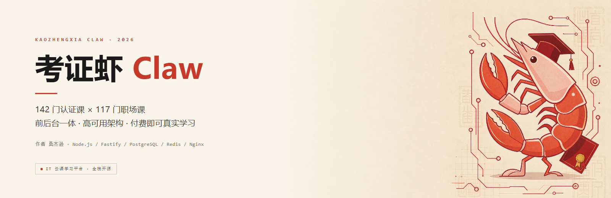
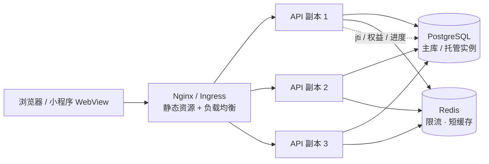
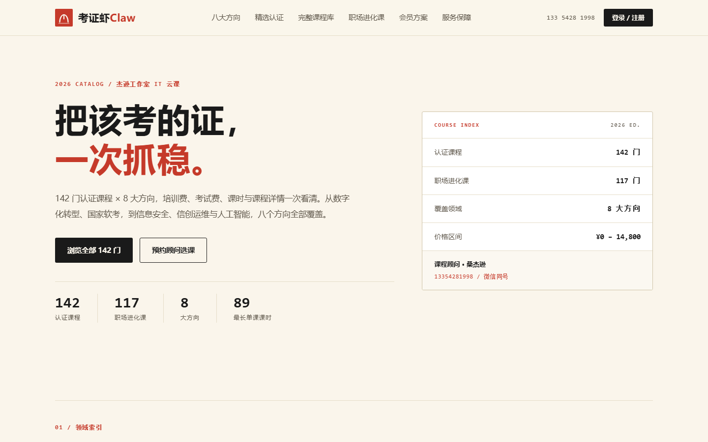

<p align="center">
  
</p>

<h1 align="center">考证虾 Claw</h1>

<p align="center">
  IT 云课学习平台 · 用户前台 + 管理后台 + 高可用后端
</p>

<p align="center">
  
  
  
  
  
  
</p>

> 142 门认证课程 × 117 门职场进化课。注册、选课、开通、进课堂、记进度，全链路真实可用；后台可管订单、学员、课程价格与上下架。

---

## 这是什么

一个把「课程目录」变成「能付费、能学习」的完整系统：

| 角色 | 入口 | 能力 |
|---|---|---|
| 学员 | `/` | 浏览 259 门课、注册登录、开通课程/精英会员、进入课堂、断点续学 |
| 管理员 | `/admin` | 经营概览、订单检索与退款、学员消费、课程调价与上下架 |
| 服务端 | `/api/*` | 认证、目录、订单、权益、进度、管理端，全部 JSON 接口 |

课程内容是**结构化讲义**（259 门课 / 3709 节），用于让「付费后能真实学习」成立；接入真实视频时替换 `lessons.body` 或改为对象存储地址即可。

---

## 功能

**用户前台**
- 142 门认证课 + 117 门职场课，按 8 大方向筛选、关键词搜索
- 手机号注册 / 登录，JWT 无状态会话，换设备登录进度不丢
- 演示支付下单（微信 / 支付宝两种方式），0 元公开课免支付直接开通
- 精英会员三档时长（1/2/3 年），开通即解锁全部职场课
- 课堂：章节 / 课时导航、讲义阅读、标记完成自动续学、进度百分比
- 我的课程：已开通课程 + 学习进度 + 会员有效期

**管理后台**
- 经营概览：累计/今日营收、注册学员、在售课程、近 14 天营收柱状图
- 订单：按状态筛选、按手机号/昵称/订单号搜索、分页、一键退款
- 学员：消费次数与累计金额
- 课程：直接改价、上架/下架，保存即对前台生效

---

## 架构



- **无状态 API**：会话只靠 JWT，任意副本都能处理任意请求，天然可水平扩容
- **多副本 + 负载均衡**：Nginx `least_conn` + upstream keepalive + 被动健康检查 + 失败重试；K8s 下用 Service + HPA
- **数据层**：PostgreSQL 连接池（`PG_POOL_MAX`），Redis 共享限流计数（未配置时自动降级为进程内）
- **可观测与自愈**：`/healthz` 存活、`/readyz` 就绪（含 DB 探测）、结构化日志带 request id
- **平滑发布**：`preStop` 等待 8s + 30s 优雅退出窗口，滚动更新 `maxUnavailable: 0`

更细的容量与故障域说明见 [docs/ARCHITECTURE.md](docs/ARCHITECTURE.md)。

---

## 目录结构

```
kaozhengxia-claw/
├─ server/                 # 后端（Fastify 5，ESM）
│  └─ src/
│     ├─ index.js          # 启动、优雅退出
│     ├─ app.js            # 安全头 / CORS / 限流 / 路由 / 静态
│     ├─ config.js         # 环境变量
│     ├─ seed.js           # 建表 + 导入课程与课时 + 管理员
│     ├─ db/               # 双数据库适配（SQLite 开发 / PostgreSQL 生产）
│     ├─ lib/              # 口令、JWT、课程生成、限流、权益
│     └─ routes/           # auth / catalog / orders / progress / admin
├─ web/
│  ├─ index.html           # 用户前台（API 驱动）
│  ├─ standalone.html      # 离线演示版（无需后端，数据存本机）
│  └─ admin/index.html     # 管理后台
├─ nginx/nginx.conf        # 边缘负载均衡与限流
├─ k8s/                    # Deployment / Service / HPA / PDB / Ingress / Seed Job
├─ docker-compose.yml      # Postgres + Redis + 3 API + Nginx
├─ Dockerfile              # 多阶段构建，非 root，健康检查
└─ assets/                 # README 封面与截图
```

---

## 快速开始

### 方式一：本机零依赖（SQLite，最快）

需要 Node.js **22.5+**（用到内置 `node:sqlite`）。

```bash
cd server
npm install
npm run seed      # 建表 + 导入 259 门课 / 3709 节课时 + 管理员
npm start
```

打开：

- 前台 <http://localhost:8080/>
- 后台 <http://localhost:8080/admin>

### 方式二：Docker Compose（PostgreSQL + Redis + 3 副本 + Nginx）

```bash
cp .env.example .env
# 生产务必改掉 JWT_SECRET 与 ADMIN_PASSWORD
export JWT_SECRET=$(node -e "console.log(require('crypto').randomBytes(32).toString('hex'))")

docker compose up -d --build
docker compose ps
```

打开 <http://localhost/>：Nginx 在前，三个 API 副本在 `least_conn` 后轮转。

> 本仓库的开发环境未安装 Docker，`docker-compose.yml` 与 `k8s/` 已按可直接上线的形态编写；本机验证走的是方式一。

### 默认管理员

| 账号 | 密码 | 说明 |
|---|---|---|
| `13354281998` | `sangjiexun@2026` | 首次 seed 创建，请用 `ADMIN_PHONE` / `ADMIN_PASSWORD` 覆盖 |

---

## API 一览

除标注「公开」外均需 `Authorization: Bearer <token>`。

| 方法 | 路径 | 说明 | 权限 |
|---|---|---|---|
| POST | `/api/auth/register` | 注册并登录 | 公开 |
| POST | `/api/auth/login` | 登录 | 公开 |
| GET | `/api/auth/me` | 当前账号 | 登录 |
| GET | `/api/courses` | 目录（课程 / 职场课 / 方向 / 精选） | 公开 |
| GET | `/api/courses/:key` | 课程详情 + 章节目录 | 公开 |
| GET | `/api/courses/:key/lessons` | 讲义正文 | 已开通 |
| POST | `/api/orders` | 下单（含 0 元课直接开通） | 登录 |
| POST | `/api/orders/:id/pay` | 支付确认（演示） | 本人 |
| GET | `/api/orders/mine` | 我的订单 | 登录 |
| GET | `/api/me/bootstrap` | 身份 + 权益 + 进度 + 课时总数 | 登录 |
| POST | `/api/progress` | 记录课时进度 | 登录 |
| GET | `/api/admin/overview` | 经营概览 | 管理员 |
| GET | `/api/admin/orders` | 订单列表 | 管理员 |
| GET | `/api/admin/users` | 学员列表 | 管理员 |
| GET | `/api/admin/courses` | 课程列表 | 管理员 |
| PATCH | `/api/admin/courses/:key` | 调价 / 上下架 | 管理员 |
| POST | `/api/admin/orders/:id/refund` | 退款 | 管理员 |

---

## 界面预览

<p align="center">
  
</p>

---

## 高可用与性能要点

| 关注点 | 做法 |
|---|---|
| 水平扩容 | API 无状态（JWT），副本数可随流量线性增加 |
| 入口容错 | Nginx `proxy_next_upstream` 自动切换故障副本；K8s 探针摘除异常 Pod |
| 发布不中断 | `maxUnavailable: 0` + `preStop` 8s + 15s 强制退出兜底 |
| 过载保护 | Nginx 40 r/s 边缘限流 + 应用层每 IP 180 次/分钟，Redis 多副本共享 |
| 数据库 | 连接池上限可调；高频路径建索引（订单用户/状态、进度用户+课程） |
| 静态资源 | Nginx 直接返回，gzip + 1h 缓存；HTML 不走缓存 |
| 容器安全 | 非 root、只读根文件系统、`capabilities: drop ALL` |

`k8s/` 已包含：3 副本 Deployment、HPA（CPU 65% / 内存 75%，3→12）、PDB（最少 2 可用）、拓扑分布、Ingress + TLS、一次性 Seed Job。

---

## 关于支付

当前 `/api/orders/:id/pay` 是**演示支付**：调用即视为成功，不产生真实扣款，页面有明确标注。

接真实支付时只需替换这一段：下单保留 `pending`，把支付网关的下单参数返回给前端，回调里校验签名后把订单置为 `paid` 并写 `expires_at`。权益判定完全基于订单状态，不需要改其它代码。

---

## 安全

- 口令 **scrypt + 随机盐**，恒定时间比较，不存明文
- JWT **HS256**，密钥来自环境变量，过期自动失效
- 全部 SQL 使用参数化查询；`?` 占位符在 PostgreSQL 侧自动转 `$n`
- 响应头：CSP、`X-Content-Type-Options`、`X-Frame-Options`、`Referrer-Policy`、HSTS（生产）
- 管理端接口统一 `preHandler` 鉴权，非管理员一律 403
- 限流同时覆盖边缘与应用层，防刷单与撞库

---

## Roadmap

- [ ] 接入真实微信 / 支付宝支付与回调验签
- [ ] 课程视频接入对象存储（OOS / S3）与防盗链
- [ ] 学习报告、结业证书、题库与模考
- [ ] 企业子账号与部门维度报表
- [ ] OpenTelemetry 链路追踪 + Prometheus 指标

---

## 作者

**桑杰逊** · 课程顾问 / 全栈

- 电话 / 微信：13354281998
- GitHub：[@ChinaOpenClaw](https://github.com/ChinaOpenClaw)

## License

[MIT](LICENSE) © 2026 桑杰逊
